<h2 align="center">大模型 + RAG 的智能问数系统</h3>


<p align="center">
<a href="#项目文档"></a>
<a href="#项目文档"></a>
<a href="#项目文档"></a>
<a href="#项目文档"></a>
<a href="#项目文档"></a>
<a href="#项目文档"></a>
<a href="#项目文档"></a>
<a href="#项目文档"></a>
<a href="#项目文档"></a>
</p>


🔥🔥 **近4W+字，共40个文档，带你玩转datacopilotx**，详情可戳：[细致文档带你吃透DataCopilotX](https://share.note.youdao.com/s/NcfQQFTs)

## 玩转DataCopilotX

### 1. 登录
`超管账号/密码：admin/datacopilotx`
登录系统我们用spring security + JWT框架搭了一个简单架子，系统的核心在于问数的过程，这种边角料的功能我们就不再赘述了。


### 2. 配置数据集
智能问数项目的核心业务价值是基于某一个数据集进行text2sql，并将结果用图表展示，所以第一步需要先创建数据集。
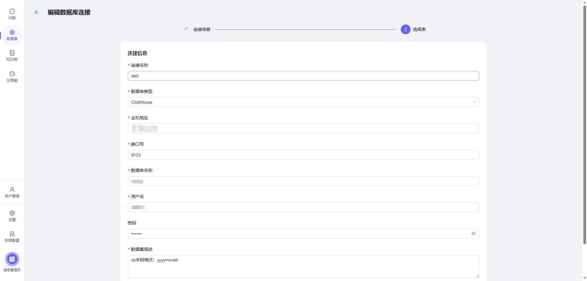
系统中的数据集就相当于数据库的概念，支持MySQL、ClickHouse、Excel三种类型的数据库类型，填写好配置信息后点击下一步选择要进行问数的表。
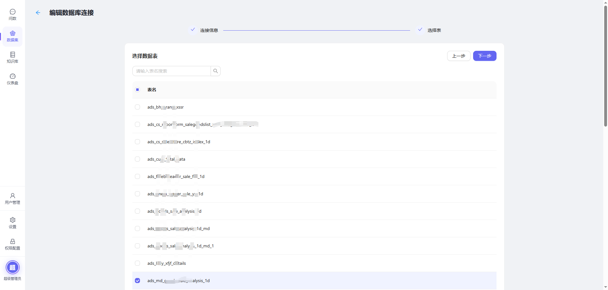
因为一个数据库下可能有很多表，有些生产环境可能几百上千张，没必要都加进来，这里我们演示只选择一张。
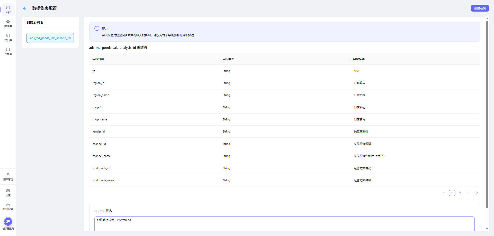
选中表后系统会自动获取表字段描述，这里有两个点要注意下
1. 如果没有的话可以手动标注一下，字段的描述会很大程度影响模型生成SQL的准确率
2. 字段中如果有特殊规则的可以在prompt注入栏中配置，比如日期格式，这样让模型回答的准确率更
#### 2.1 数据集联表配置
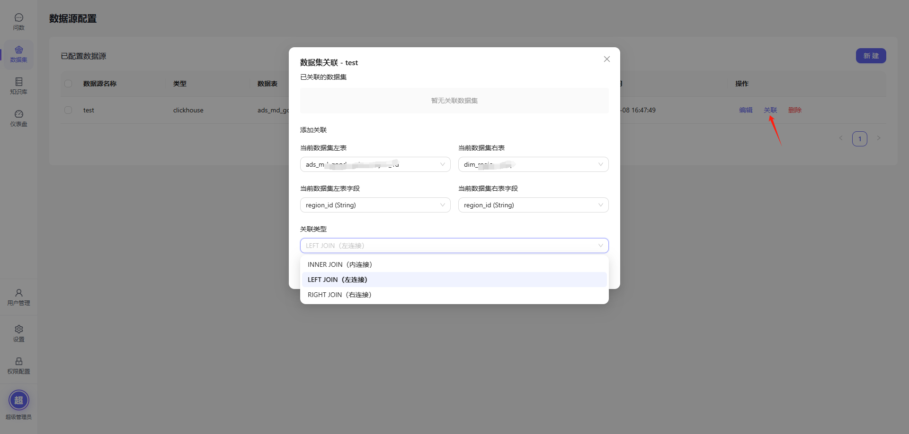
系统不仅支持单表查询，还支持配置联表条件，模型自动识别是否符合联表条件，生成出正确的联表SQL

### 3. 术语配置
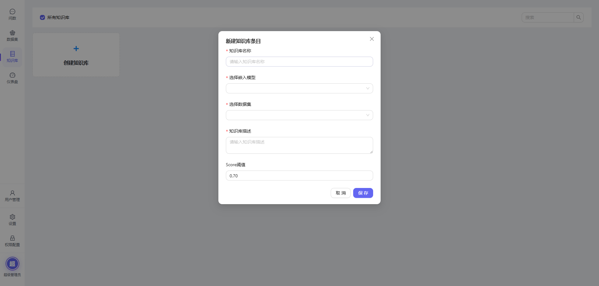
该功能用于配置一些名词替换，大模型在处理text2sql时会对一些名词替换产生错误，如食品饮料产品线的销售总额，如果不配置术语，大模型自然的认为product_line = '食品饮料产品线'，
但这显然是错的，因为数据库里通常并不会存储中文，正确应该是product_line = 'Food and beverages'。这时候就可以在这里配置一条术语:
```
key = '食品饮料产品线'
value = 'Food and beverages'
```
当模型遇到包含食品饮料产品线的问题，召回对应的映射回答，即可满足效果。
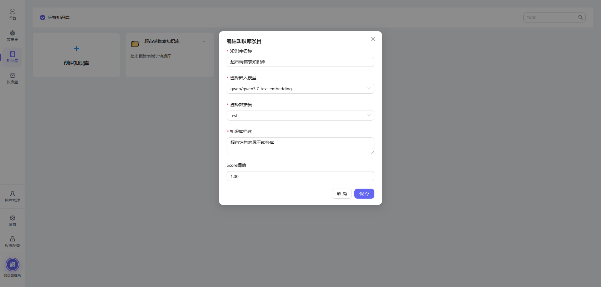
这里有个Score阈值可能有同学不懂，我们可以先有个印象，RAG召回的时候会给相关的结果打分，低于这个Score阈值的忽略掉，只有得分高于Score的才认为是相关。
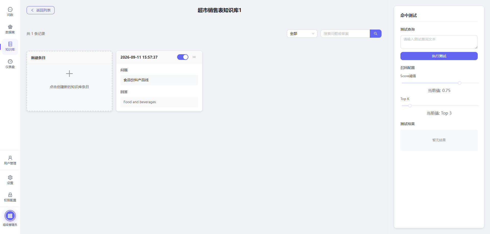

### 4. 问数
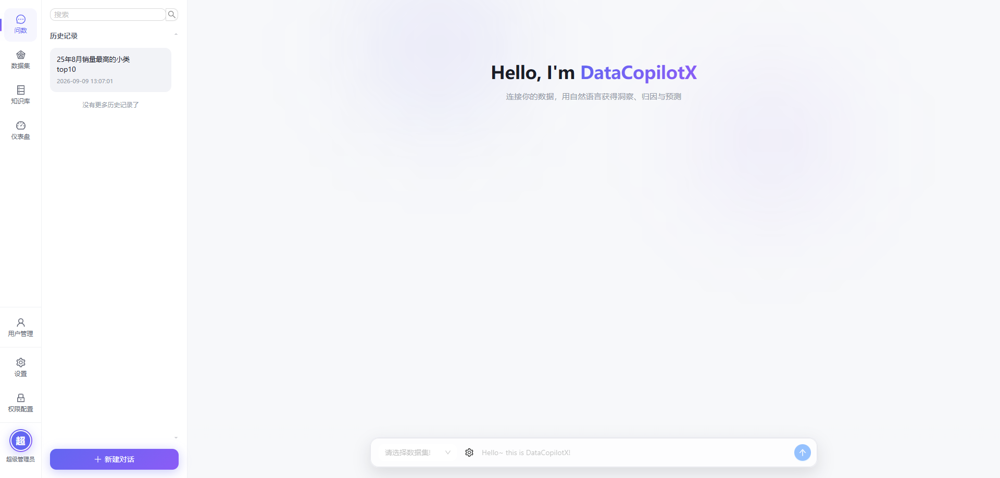
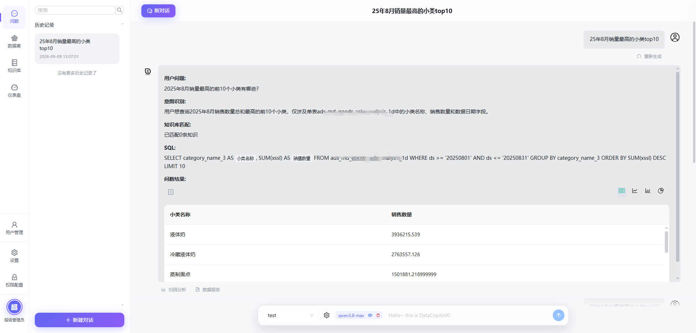
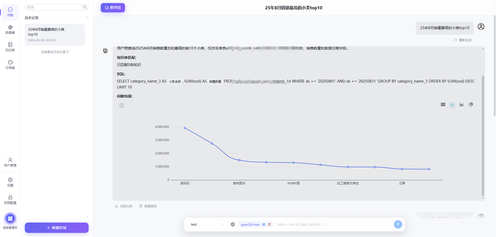


## 智能问数DataCopilotX介绍

**核心功能** ：基于大模型自然语言处理的数据分析系统，通过对话的方式用户可以直接用中文提问，例如“近三个月各选择采购订单的入库总金额Top 5”，系统会理解问题、生成SQL、查询结果、图表展示

**意义**：让数据分析如聊天般简单,通过文本输入问题，平台自动理解业务需求，智能生成 SQL 查询并提取数据，自动选择最佳可视化图表呈现结果

## 项目特性

- **简单易用**：通过自然语言对话方式获取数据，通过图表渲染，一分钟上手
- **开箱即用**：只需配置大模型和数据源即可开启问数之旅，通过大模型和 RAG 的结合来实现高质量的 text2sql
- **容器化部署**：支持docker部署
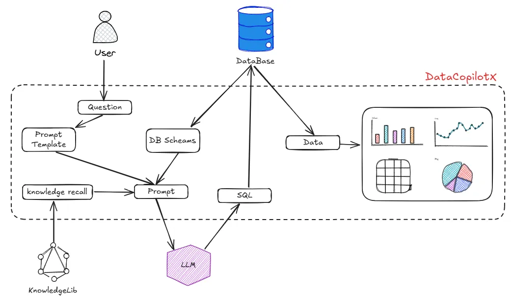

## 项目技术栈
| 依赖					               | 版本					      |描述
|-----------------------|--------------|-------
| Spring Boot			        | 3.3.4					   |项目脚手架
| Spring WebFlux			     | 3.3.4					   |流式Web框架
| MyBatis Plus			       | 3.5.7					   |持久层框架
| MySQL					            | 8.0					     |DB数据库
| ElasticSearch					    | 8.13.4					  |向量库、支持流转的数据库
| HikariCP					         | 5.1.0 ↑					 |数据库连接池
| LangChain4J					      | 1.0.1					   |大模型服务框架
| LangGraph4J				       | 1.6.2					   |大模型服务框架
| Ollama					           | x					       |大模型执行框架
| Maven					            | 3.6.X					   |Java包管理
| Vue.js					           | 3.X					     |前端框架
| AntDesign X Vue UI			 | 1.1.2					   |前端UI
| Docker					           | 					        |容器化部署


## 项目文档
[细致文档带你吃透DataCopilotX](https://share.note.youdao.com/s/NcfQQFTs)